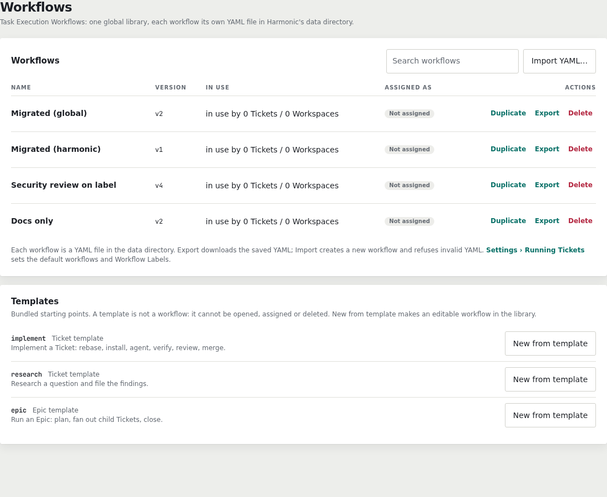

A **workflow** is the list of steps Harmonic runs for a ticket: rebase, build,
verify, review, merge and so on. The **Workflows** page lists every workflow
in your library.

`implement`, `research` and `epic` are in the library from the first boot.
They are ordinary workflows, so you can open and edit any of them straight
away.

## Edit a workflow

Click a workflow's name to open it. The editor has three views:

- **Blocks** shows the steps as blocks you can move, add and remove.
- **YAML** shows the same workflow as text, with errors inline.
- **Variables** lists the workflow's variables and their defaults.

Save writes a new version. Save stays disabled while the workflow has errors.

## Templates

Below the library, the **Templates** section lists the starting points that
ship with Harmonic: `implement`, `research` and `epic`. A template is not a
workflow. You can't open, assign or delete it. It only exists to be copied.

### New from template

1. Click **New from template** on a template's row.
2. Enter a name for the new workflow.
3. Create it. The new workflow opens in the editor.

The copy is a normal library workflow at version 1. Editing it never changes
the template, so you can start again from the same template at any time.

## Duplicate

**Duplicate** on a workflow's row copies that workflow, including your edits,
into a new workflow. Use it to branch off a variant of a workflow you have
already tuned. Use **New from template** to start from the shipped version.

## Configure the Critic

The Critic reviews a ticket's work after verification passes. In `implement`
it is off until you turn it on.

1. Open **Workflows** and click `implement`.
2. Open the **Variables** tab and set `review` to `true`.
3. Open the **Blocks** tab and find the `critic` step under `review`.
4. Choose its **Harness**, then its **Model**. The Model list belongs to the
   Harness you picked.
5. Click **Save**.

New Attempts of tickets that use `implement` now run the Critic. The `epic`
workflow has its own `critic` step, which runs on every Epic. Edit it the same
way.

See [Review & merge](/work/reviewing-and-merging/) for what a Critic checks
and what happens when it rejects work.
